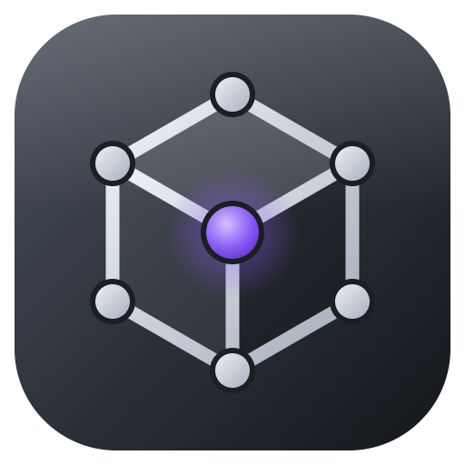

# Graphite



A local knowledge base for studying (formerly **MyObsidian**). Your notes are plain Markdown files in a folder (the **vault**), so nothing is locked in.

## Desktop app (recommended)

Run **`dist\Graphite-Setup-<version>.exe`** to install Graphite like any Windows program, with a Start menu entry and a desktop shortcut. On first launch it asks where your notes live: open an existing folder (an Obsidian vault works too), or create a new vault with starter notes. To switch vaults later, go to **Settings → General → Open another vault…**.

The installer isn't code-signed, so Windows SmartScreen may say "Windows protected your PC". Click **More info → Run anyway**.

Shortcuts that only exist in the desktop app: `Ctrl+=` / `Ctrl+-` / `Ctrl+0` to zoom, `F11` for full screen, and `F12` or `Ctrl+Shift+I` for developer tools (useful for debugging plugins).

**Updates:** the installed app checks for a newer version at startup, every 10 minutes, and when you return to the window, in two places:
- **GitHub releases:** the latest release of the repo set in `package.json` → `graphite.updateRepo` ("owner/name", a public repo). Its `Graphite-Setup-<version>.exe` asset is downloaded when you press Update (the Update button fills up as it downloads). GitHub is asked at most every 15 minutes. `npm run publish` ([scripts/publish-github.js](scripts/publish-github.js)) creates the release for the current build, using the GitHub CLI or a `GITHUB_TOKEN`.
- **The local `dist` folder** recorded at build time (for development).

When a newer version is found, an **Update** button appears in the ribbon and under **Settings → General → Updates**. Clicking it saves your notes, runs the installer silently and reopens the app.

**Renamed from MyObsidian:** the installer keeps the same app ID, so it upgrades the old install in place. On first start, Graphite copies your settings (vault, language, AI keys) from `%APPDATA%\MyObsidian`. Each build is also saved as `MyObsidian-Setup-<version>.exe`, so copies installed before the rename still find the update. Plugin data and storage keys keep their old internal names (`.obsidian/myobsidian/`, `mo:`), so nothing is lost.

How it works: the desktop app is built with Electron. Inside it, the same server code runs on a random port, and it only answers requests that carry a secret key generated at each launch, so other programs on your PC can't read your notes through it.

### Developing the desktop app

```bash
npm run app
```

`npm run app` runs it from source. Add `-- --vault="D:\path"` to skip the vault dialog.

```bash
npm run dist
```

`npm run dist` builds the installer into `dist/`. Each build raises the version by one step (1.1.0 → 1.1.1) and removes the previous installer. To jump to a specific version, run `node scripts/bump-version.js 2.0.0` before `npx electron-builder --win`. The current version is shown in **Settings → General**. `npm run icon` re-renders `build/icon.png` from `build/icon.svg` (the Graphite logo: a graphite crystal drawn as a graph of linked notes). `npm run icons` rebuilds the UI icons in `public/icons.js` from [Lucide](https://lucide.dev). New vaults are filled from `sample-vault/`.

Newer npm versions skip install scripts. If `npm run app` says Electron isn't installed, run `node node_modules/electron/install.js` once.

## Browser version

Double-click **`start.bat`**, or from a terminal:

```bash
npm start
```

It opens as an app window (Edge app mode) at http://localhost:3000. Only this computer can reach it.

To use a different folder, such as an existing Obsidian vault:

```bash
node server.js "D:\path\to\your\vault"
```

Options: `PORT=4000` sets the port, and `--no-open` stops it opening a window.

## Features

- **File explorer**: folders, drag and drop to move, right-click to rename/copy/delete. Deleted items go to `vault/.trash`.
- **Editor**: Edit, Split and Read views. Saves automatically. Lists continue when you press Enter, Tab indents, and `Ctrl+B` / `Ctrl+I` / `Ctrl+K` format text.
- **Wikilinks**: `[[Note]]`, `[[Note|alias]]`, `[[Note#Heading]]`, with `[[` autocomplete. Clicking a link to a note that doesn't exist creates it.
- **Renaming a note updates every link to it.**
- **Embeds**: `![[Note]]`, `![[Note#Heading]]`, `![[image.png]]`, `![[image.png|300]]`, PDFs, audio and video.
- **Pasting or dropping images** saves them into `attachments/`.
- **Math (LaTeX)**: `$inline$` and `$$display$$` formulas, rendered offline with KaTeX, including `\ce{…}` chemistry. Amounts like "$5 or $10" are left alone, and `\$` shows a literal dollar sign. The help area (F1) has three tabs, **Guide | Markdown cheatsheet | LaTeX cheatsheet**, in all 7 languages. The Markdown cheatsheet covers every piece of syntax Graphite understands, and the LaTeX cheatsheet covers about 160 commands. Both show what you type next to a live result, and you can click any example to copy it. Example links in the cheatsheets never create notes. The pages are generated by `node scripts/make-markdown-cheatsheet.js` and `node scripts/make-latex-cheatsheet.js`.
- **Obsidian Markdown**: frontmatter properties, `#tags`, `==highlight==`, `%%comments%%`, callouts (`> [!note]`, foldable with `-`/`+`), and task lists you can tick in reading view.
- **Backlinks, unlinked mentions, outgoing links, outline and tags** in the right sidebar.
- **Search** across all notes. Supports `#tag`, `path:folder`, `file:name` and `"exact phrase"`.
- **Graph view** ([public/graph.js](public/graph.js)): global or local graph, drag nodes, zoom and pan, and optionally show unresolved links and attachments. It is modelled loosely on how a brain stores and recalls memories:
  - **Regions:** label propagation over links and associations groups notes into coloured regions, named after their shared tag or hub note.
  - **Associations:** dashed lines join each note to its most similar unlinked notes (TF-IDF cosine similarity).
  - **Memory:** brightness follows quiz memory (a forgetting curve with about 90% recall on the due day). Notes due for review pulse orange.
  - **Spreading activation:** clicking a note sends a pulse along its connections, weaker at each step, and a card lists what it brings to mind. Double-click opens the note.
  - **Let my mind wander:** a weighted random walk along the strongest connections, with occasional jumps, leaving a clickable train of thought.
  - The Regions, Associations and Memory switches are remembered on this computer.
- **Quick switcher** (`Ctrl+O`), **command palette** (`Ctrl+P`), **daily notes** (`Alt+D`), random note, and light/dark theme.
- **Live reload**: files you change in other programs show up immediately.
- **Languages**: English, Français, Español, 日本語, 한국어, 简体中文 and 繁體中文. The app follows your system language on first launch. Switch it with the 🌐 button at the bottom of the left ribbon, or with “Change language” in the command palette. Each language uses the matching Windows font (Yu Gothic, Malgun Gothic, Microsoft YaHei, Microsoft JhengHei), and word counts treat Chinese and Japanese characters as one word each.

  To add a language, add an entry to `LANGS` and a dictionary to `D` in [public/i18n.js](public/i18n.js). Any key you leave out falls back to English.

## Review and memory

Graphite turns your notes into questions and helps you revise them with spaced repetition ([public/review.js](public/review.js)). It works fully offline.

- **Questions:** each note produces its own questions.
  - `==highlighted==` or **bold** words become fill-in-the-blank questions.
  - `- **Term**: definition` becomes "What is Term?".
  - `question :: answer`, or a question, a line with just `?`, then the answer, becomes a flashcard.
  - Every section with a heading becomes "What do you remember about …?".
- **Check for mistakes** ([public/check.js](public/check.js)): the 🔎 button or `Ctrl+Shift+E` lists problems in the open note as old text → corrected text with a reason. **Apply** fixes one (`Ctrl+Z` undoes it), **Apply all** fixes every one that has a correction, **Show in note** jumps to it. Offline, a basic check finds repeated words, missing spaces after punctuation, double spaces, broken `[[links]]` (suggesting the closest note), unclosed `**`/`==`/`~~` and skipped heading levels. With an AI chosen for Check, it also checks facts, spelling, grammar, clarity and logic.
- **Quiz:** the 🎓 button or `Ctrl+Shift+K` quizzes you on the open note. With an AI chosen for quiz questions, it adds up to 8 questions of its own, written once per version of the note and stored with your progress.
- **After writing:** when you leave a note you just wrote in, a card offers **Check** or **Quiz me**. Both are also in the right-click menu. The card can be turned off in Settings → Review.
- **Revision plan** ([public/studyai.js](public/studyai.js)): **Make a revision plan** (Review page or command palette). Enter the exam, its date, what is examined, the folders in range and minutes per day. The AI writes a day-by-day plan with checkboxes, weakest and due topics first (it gets each note's memory strength from your quiz history), and saves it to `<Course>/复习计划 Review Plans/`.
- **Exam paper analysis:** **Analyse an exam paper** (Review page, command palette, or right-click a PDF or note in the file list). It lists every problem with its topic and the note that covers it, explains mistakes when answers or marks are visible, and adds suggestions and a plan, saved to `<Course>/考试分析 Exam Analysis/`. API models get the PDF's text; scanned PDFs need Claude Code, which can read them.
- **Tidy format:** the 🪄 button or `Ctrl+Shift+Y` reformats the open note to match up to three other notes in its folder (frontmatter, headings, numbering, source and Related lines, maths), keeping the content. You see the changes and a before/after preview first, and `Ctrl+Z` undoes it.
- **Choosing the AI** ([public/ai.js](public/ai.js)): in **Settings → AI → Which AI does each job**, each job (Check, Quiz questions, Chat panel, Revision plans, Exam analysis, Tidy format) has its own choice, and Check and the chat panel also have a menu right where you use them:
  - **Claude Code (no key):** the Claude Code window on this computer does the job. The app writes it to `.obsidian/plugins/claude-chat/chat/tasks/<id>.json`; the obsidian-chat skill's watcher hands it to Claude, which writes `replies/<id>.json`. It only works while that window is connected ("connect to Graphite"); otherwise the app says so (quiz questions just fall back to the built-in ones).
  - **API models with your own key:** Anthropic (Claude, through the official `@anthropic-ai/sdk`), OpenAI, Google Gemini, DeepSeek, Qwen, Kimi, GLM, or any OpenAI-compatible URL (OpenRouter, a local Ollama…). The rest go through one OpenAI-compatible code path in [server.js](server.js), with JSON mode and a retry without optional fields when a provider rejects them. **Test the key** loads the provider's live model list (model names change often, so none are hard-coded beyond suggestions), and you can type any model name.
  - Keys are kept only on this computer (app settings, not the vault) and never logged. Only the note or paper for the job is sent, and only to the provider you chose, which bills the API use. Check and Quiz questions can also be set to Off.
- **Daily review:** the 🧠 ribbon button (`Alt+R`) shows how many questions are due and opens the Review page, which lists what's due, your streak, a 14-day chart, notes to revise, and notes not checked yet. Rate each answer **Again / Hard / Good / Easy** to schedule the next review (SM-2 style).
- **Related notes:** the right sidebar suggests notes on similar topics (TF-IDF word similarity) that aren't linked yet, with a one-click **Link** button.
- **Where progress is stored:** in the vault at `.obsidian/myobsidian/review.json`, so it syncs with your notes and survives renames.

The desktop app also has a right-click menu: edit actions, a Format submenu, "Search for …", link and image actions, "Check this note for mistakes" and "Quiz yourself on this note".

**Study pages:** the interactive review pages (plans, topic quizzes, level tests) are `.html` files in each course's `学习页面 Study Pages` folder, so they show in the file list. Clicking one (or a `[[Page.html]]` link) opens it as a 🎓 tab, with progress saved and quiz scores written to the Claude Brain. Any `.html` file in the vault opens the same way, and all of them are also listed under **+** (new tab).

## Sync across devices

Put your vault inside a cloud folder (OneDrive, Dropbox, Google Drive or iCloud Drive) and open the same folder in Graphite on each computer. **Settings → Sync** shows whether the vault is synced and which cloud folders exist on this PC.

Sync safety ([public/sync.js](public/sync.js)):
- **Edits on two devices at once:** saving tells the server which version the app last saw. If the file changed on disk in the meantime, the two versions are merged line by line. Edits in different places are combined, and when both devices only added lines, both sets are kept.
- **Same lines changed on both:** your version stays in the note, and the other device's version is saved next to it as `Name (conflict YYYY-MM-DD HHmm).md`. A notice links to it, and the status bar shows ⚠ while any conflict copies exist.
- **Other apps' conflict copies:** copies made by Dropbox, OneDrive and Syncthing are recognised and listed under Settings → Sync too.
- **Note deleted elsewhere while you're editing it:** your copy is kept.
- **Cloud and Windows clutter:** files such as `desktop.ini`, `Thumbs.db`, `~$…` and `*.tmp` are hidden.

## Built-in guide

Press **F1**, or click **?** in the left ribbon, to open the guide inside the app. It is written in all 7 languages and covers writing, linking, search syntax, the graph, every shortcut, and plugins. The guide files are in `public/help/<language>.md`.

## Obsidian plugins

Graphite runs Obsidian community plugins through a compatibility layer ([public/plugins.js](public/plugins.js)). Plugins use the same folder layout as Obsidian (`<vault>/.obsidian/plugins/<id>/`). If you open an existing Obsidian vault, plugins already installed there are listed automatically.

1. Open **Settings** (gear icon or `Ctrl+,`), then **Community plugins**, then **Turn on community plugins**.
2. Click **Browse** to search the official list of more than 10,000 plugins, then click **Install**. You can also copy a plugin folder into `.obsidian/plugins/` yourself.
3. Turn a plugin on with its switch. A gear icon next to it opens the plugin's own settings.

**What works:** commands and their hotkeys, ribbon icons, status bar items, settings pages, Markdown post-processors and code-block processors, editor suggestions, the file context menu, pop-up windows and suggestion lists, notices, Lucide icons, `moment`, YAML, `requestUrl`, and the `vault`, `metadataCache`, `workspace`, `fileManager` and editor APIs.

**What doesn't:** custom panels (`registerView`) and CodeMirror editor extensions. Plugins that also include these still load, but those parts do nothing.

A small example plugin, **Note Stats**, comes installed. It adds reading time, a statistics window, a `stats` code block and `@today` date suggestions. Its source in `vault/.obsidian/plugins/note-stats/main.js` is a short example of how to write a plugin.

## Shortcuts

| Action | Keys |
| --- | --- |
| Quick switcher | `Ctrl+O` |
| Command palette | `Ctrl+P` |
| New note | `Alt+N` |
| Edit / Read toggle | `Ctrl+E` |
| Graph view | `Ctrl+G` |
| Search | `Ctrl+Shift+F` |
| Daily note | `Alt+D` |
| Rename note | `F2` |
| Back / Forward | `Alt+←` / `Alt+→` |
| Save now | `Ctrl+S` |
| Settings | `Ctrl+,` |
| Guide | `F1` |
| Check note for mistakes | `Ctrl+Shift+E` |
| Quiz on this note | `Ctrl+Shift+K` |
| Review | `Alt+R` |

## Project layout

- `server.js`: a small Node server with no framework. It handles the file API, live updates and static files.
- `public/`: the app itself (`index.html`, `app.js`, `style.css`).
- `vault/`: your notes.
