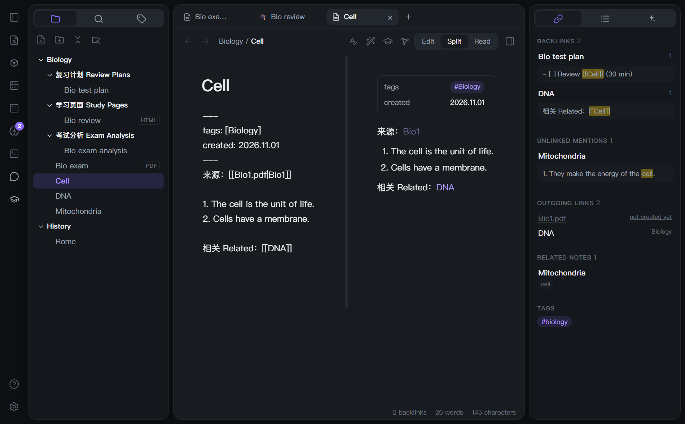
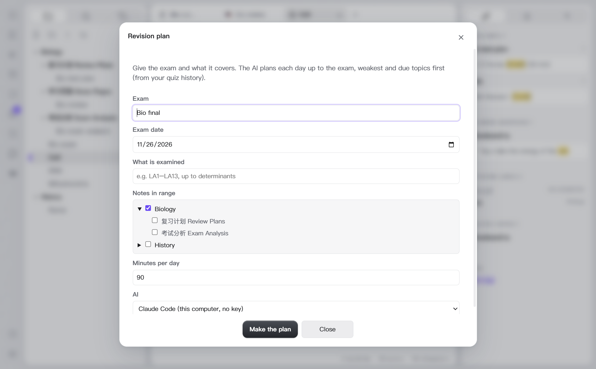
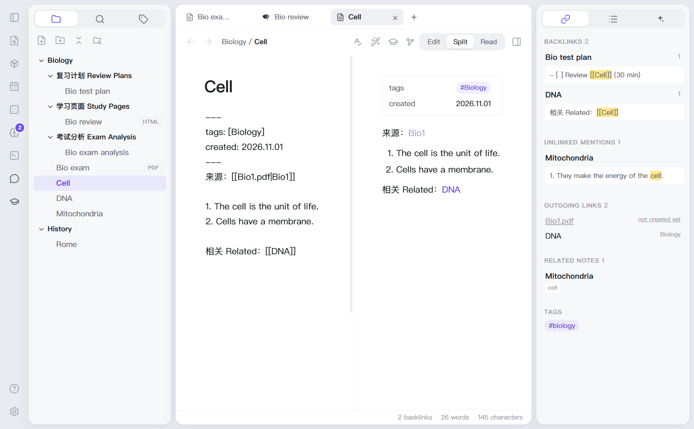

<p align="center">
  
</p>

<h1 align="center">Graphite</h1>

<p align="center"><b>A local-first notebook for studying.</b><br>
Plain Markdown notes, a graph that behaves like memory, spaced repetition, and AI that checks, quizzes and plans with you.</p>

<p align="center">
  <a href="https://github.com/baylorinf/Graphite/releases/latest"><b>Download for Windows</b></a> ·
  <a href="#features">Features</a> ·
  <a href="#ai">AI</a> ·
  <a href="#development">Development</a>
</p>



Your notes stay plain `.md` files in a folder on your computer (the **vault**), so nothing is locked in, and existing Obsidian vaults open as they are. Graphite was previously called MyObsidian.

## Install

1. Download `Graphite-Setup-<version>.exe` from the [latest release](https://github.com/baylorinf/Graphite/releases/latest) and run it.
2. On first launch, open a folder of notes or create a new vault with starter notes.

The installer isn't code-signed, so Windows SmartScreen may say "Windows protected your PC". Click **More info → Run anyway**.

Graphite updates itself: when a newer release is published here, an **Update** button appears in the left rail. Clicking it downloads the new version (the button fills up as it goes), installs it silently and reopens the app.

## Features

### Write

- **Editor** with Edit, Split and Read views, autosave, list continuation, and `Ctrl+B` / `Ctrl+I` / `Ctrl+K` formatting.
- **Links:** `[[Note]]`, `[[Note|alias]]`, `[[Note#Heading]]` with autocomplete. Renaming a note updates every link to it.
- **Embeds:** notes, headings, images, PDFs, audio and video. Pasted or dropped images are saved into `attachments/`.
- **Maths:** `$inline$` and `$$display$$` LaTeX rendered offline with KaTeX, including `\ce{…}` chemistry.
- **Obsidian Markdown:** frontmatter properties, `#tags`, `==highlights==`, `%%comments%%`, callouts and task lists.
- **Files in tabs:** notes, PDFs (with search, zoom and links to a page), images, audio and video open as tabs.
- **Built-in help (F1)** in 7 languages, with a Markdown cheatsheet and a LaTeX cheatsheet of about 160 commands.

### Connect

- **Backlinks, unlinked mentions, outgoing links, outline, tags,** and **related notes** (similar wording, not linked yet) with a one-click Link button.
- **Search** with `#tag`, `path:folder`, `file:name` and `"exact phrase"`.
- **Graph view that works like memory:**
  - **Regions:** closely connected notes gather into coloured areas.
  - **Associations:** dashed lines join notes about similar ideas that you haven't linked.
  - **Memory:** notes you remember well glow, notes you're forgetting fade, and notes due for review pulse.
  - **Click a note to see what it brings to mind:** a pulse spreads along its connections.
  - **Let my mind wander:** drifts from thought to thought and leaves a trail.

### Remember

- **Quizzes from your notes:** highlights, **bold** terms, `- **Term**: definition`, `question :: answer` and headings become questions.
- **Spaced repetition:** daily review with Again / Hard / Good / Easy, a streak and a 14-day chart.
- **After writing,** a card offers to check the note or quiz you on it.
- **Study pages:** interactive review pages (`.html`) in a course's `Study Pages` folder open as 🎓 tabs, with progress saved.

### Study with AI

| Tool | What it does |
| --- | --- |
| **Check** (`Ctrl+Shift+E`) | Finds wrong facts, spelling, grammar and unclear sentences, shown as old → new with a reason; apply one or all. Works offline too, with a basic check. |
| **Quiz questions** (`Ctrl+Shift+K`) | Adds AI-written questions to your quiz, refreshed whenever the note changes. |
| **Revision plan** | From an exam date and range, a day-by-day checklist that puts your weakest and due topics first. |
| **Exam analysis** | From an exam paper or a graded exam: every problem, its topic and your matching note, what went wrong, and a plan. |
| **Tidy format** (`Ctrl+Shift+Y`) | Makes a note follow the format of the other notes in its folder, with a before/after preview. |
| **Chat panel** | Ask about the note or the text you're reading; answers render Markdown and maths. |



### Everything else

- **Sync** through any cloud folder (OneDrive, Dropbox, Google Drive, iCloud Drive), with line-by-line merging and conflict copies when two devices edit the same lines.
- **Obsidian community plugins** run through a compatibility layer: browse and install the official list from Settings. Custom panels (`registerView`) and CodeMirror extensions aren't supported.
- **7 languages:** English, Français, Español, 日本語, 한국어, 简体中文, 繁體中文.
- **Dark and light themes.**



## AI

Every AI job (Check, Quiz questions, Chat, Revision plans, Exam analysis, Tidy format) can use a different AI, chosen in **Settings → AI**:

- **Your own API key** for **Anthropic (Claude)**, **OpenAI**, **Google Gemini**, **DeepSeek**, **Qwen**, **Kimi**, **GLM**, or any **OpenAI-compatible** service (OpenRouter, a local Ollama, …). **Test the key** loads the provider's current model list, or you can type any model name.
- **Claude Code (no key):** if you use [Claude Code](https://claude.com/claude-code) on the same computer, Graphite can hand jobs to it through files in the vault (with the companion `obsidian-chat` skill). It works only while that Claude window is connected. This is also the only option that can read scanned PDFs and reorganise several notes at once.

**Privacy:** keys are stored only on your computer, never in the vault, and never logged. A job sends only its own note or paper, and only to the provider you chose, which bills you for the use.

## Shortcuts

| Action | Keys | | Action | Keys |
| --- | --- | --- | --- | --- |
| Quick switcher | `Ctrl+O` | | Graph view | `Ctrl+G` |
| Command palette | `Ctrl+P` | | Daily note | `Alt+D` |
| New note | `Alt+N` | | Review | `Alt+R` |
| Edit / Read | `Ctrl+E` | | Check for mistakes | `Ctrl+Shift+E` |
| Search | `Ctrl+Shift+F` | | Quiz this note | `Ctrl+Shift+K` |
| New tab / close tab | `Ctrl+T` / `Ctrl+W` | | Tidy format | `Ctrl+Shift+Y` |
| Rename note | `F2` | | Settings | `Ctrl+,` |
| Back / Forward | `Alt+←` / `Alt+→` | | Guide | `F1` |

## Development

Requirements: Node.js 20+ and Windows (for the installer).

```bash
npm install
```

```bash
npm run app
```

`npm run app` runs the desktop app from source. Add `-- --vault="C:\path\to\vault"` to skip the vault dialog. Newer npm versions skip install scripts; if Electron says it isn't installed, run `node node_modules/electron/install.js` once.

```bash
npm start
```

`npm start` runs the same app in a browser at http://localhost:3000, reachable only from this computer.

```bash
npm run dist
```

`npm run dist` raises the version by one step and builds `dist/Graphite-Setup-<version>.exe`. It also saves a copy as `MyObsidian-Setup-<version>.exe`, so installs from before the rename find the update.

```bash
npm run publish
```

`npm run publish` creates a GitHub release for the current build and uploads the installer, which is what installed copies update from. It needs a logged-in [GitHub CLI](https://cli.github.com) or a `GITHUB_TOKEN` environment variable. The repository is set in `package.json` → `graphite.updateRepo`.

Other scripts: `npm run icon` renders `build/icon.png` from `build/icon.svg`; `npm run icons` rebuilds the UI icons (`public/icons.js`) from [Lucide](https://lucide.dev); `node scripts/make-markdown-cheatsheet.js` and `node scripts/make-latex-cheatsheet.js` regenerate the cheatsheets.

### How it works

- **Desktop app:** Electron ([electron/main.js](electron/main.js)). Inside it, the same Node server runs on a random port and only answers requests that carry a secret generated at each launch, so other programs can't read your notes through it.
- **Server:** [server.js](server.js), with no framework. It provides the file API, live reload when files change on disk, sync conflict checks, and the AI endpoint. Anthropic goes through the official `@anthropic-ai/sdk`; every other provider goes through one OpenAI-compatible path.
- **App:** plain ES modules in [public/](public):

| File | What it does |
| --- | --- |
| `app.js` | The editor and the rest of the app |
| `graph.js` | The graph view |
| `review.js` | Questions and spaced repetition |
| `check.js` | Check for mistakes |
| `ai.js` | AI choices, keys and the Claude Code bridge |
| `studyai.js` | Revision plans, exam analysis and Tidy format |
| `plugins.js` | The Obsidian plugin layer |
| `i18n.js` | Translations |
| `graphite.css` | The design |

- **Data:** notes are plain files. Review progress is in the vault at `.obsidian/myobsidian/review.json`, so it syncs with your notes. App settings and API keys stay in the app's own settings folder.
- **Adding a language:** add an entry to `LANGS` and a dictionary to `D` in [public/i18n.js](public/i18n.js); missing keys fall back to English. The guides are in `public/help/<language>.md`.
